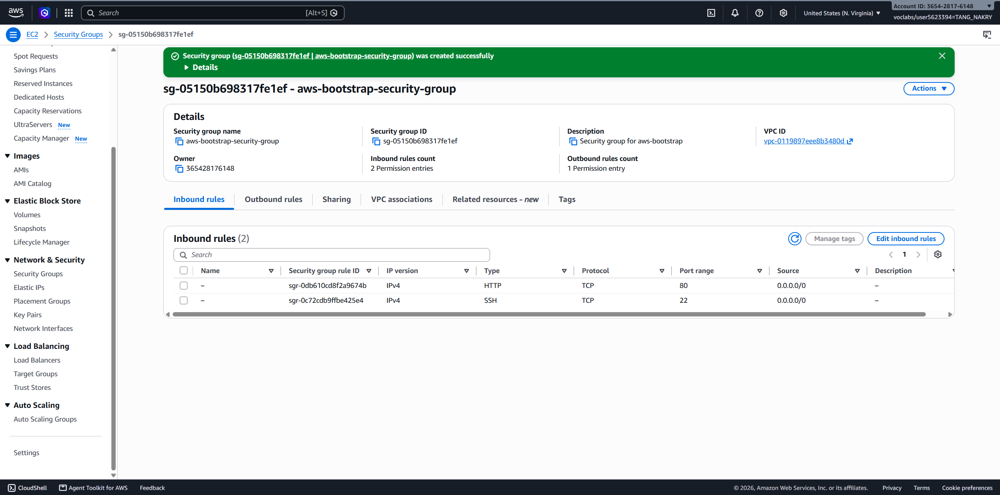
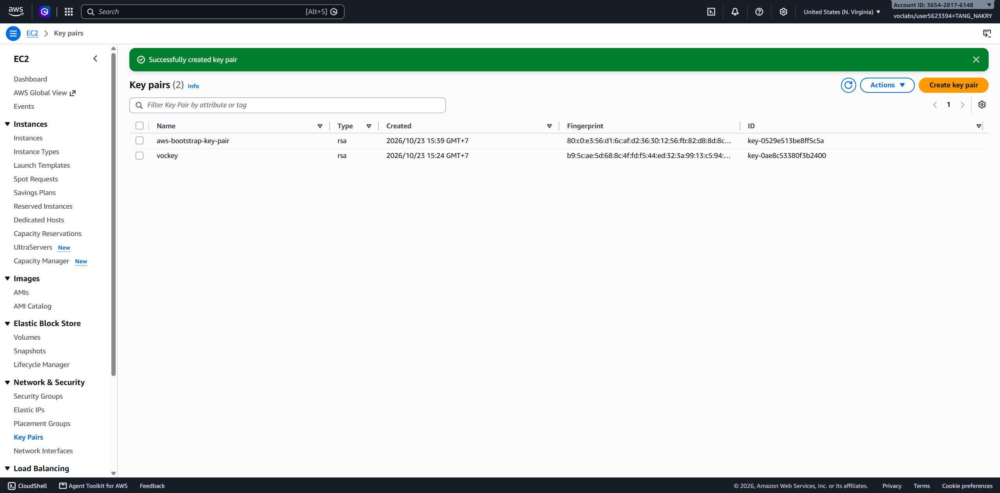
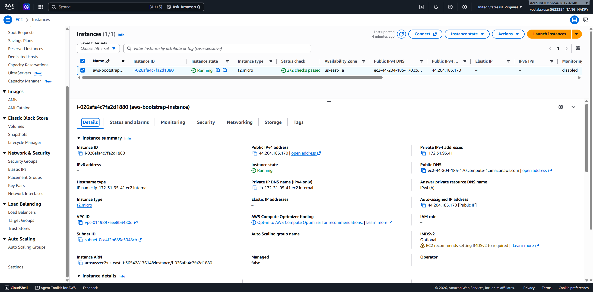
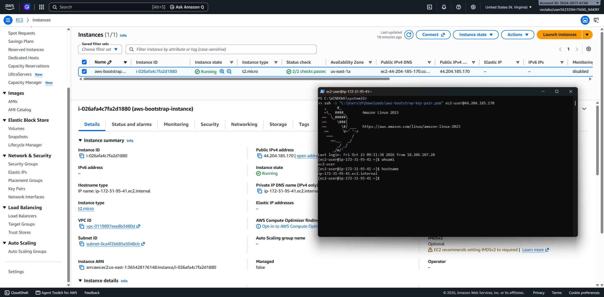
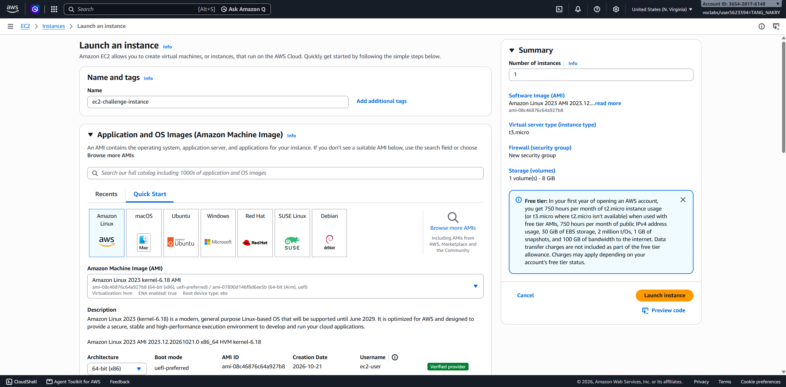
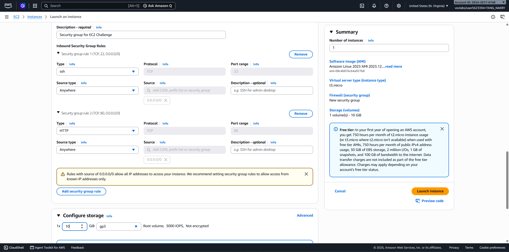
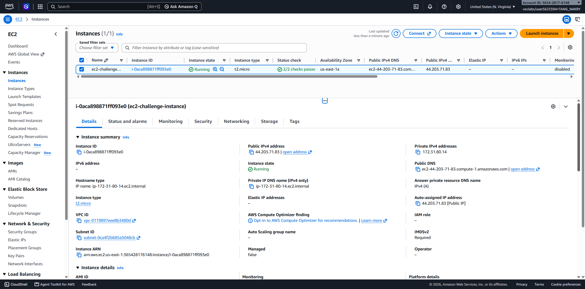
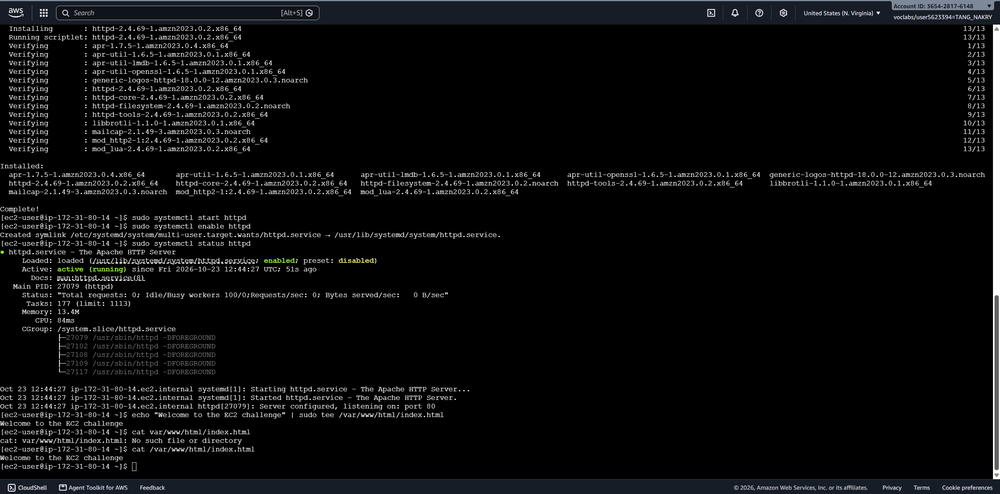

# Cloud Computing - LAB01

## Part 1.1 — Amazon EC2 Walkthrough

### 1. Create Security Group

### 2. Create Key Pair

### 3. Launch EC2 Instance

### 4. Test Website in Browser

### 5. Connect to EC2 via SSH

---

## Part 1.2 — EC2 Web Solution Challenge

### 6. Launch Challenge Instance

### 7. Configure Security Group

### 8. Verify Running Instance

### 9. Install Apache and Create Web Page

### 10. Test Challenge Website

