# Cloud Lab 2 Submission — Load Balancer and Auto Scaling

- **Student name:** TANG NAKRY
- **Student ID:** e20220304

---

## Security groups

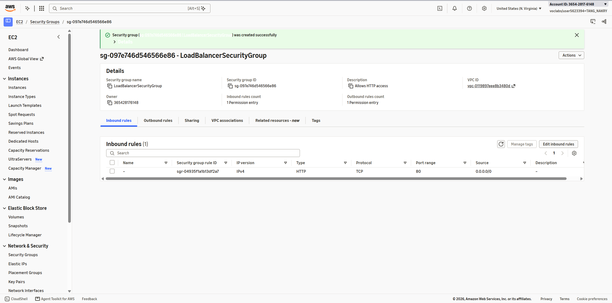

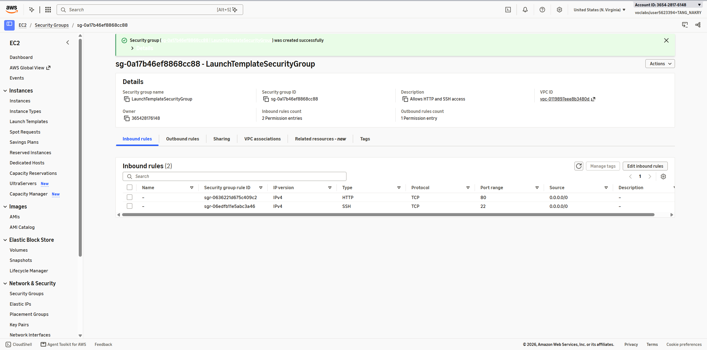

## Target group

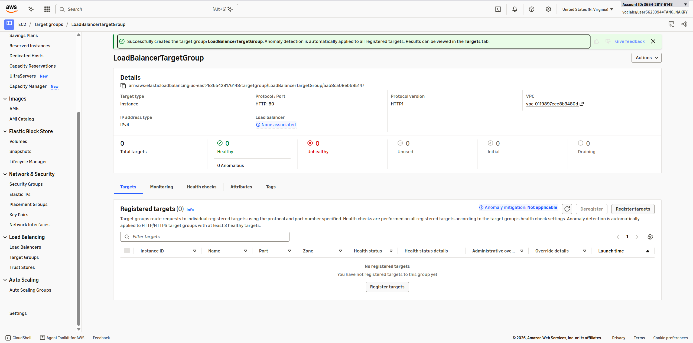

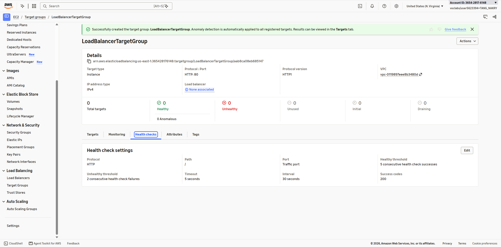

## Application Load Balancer

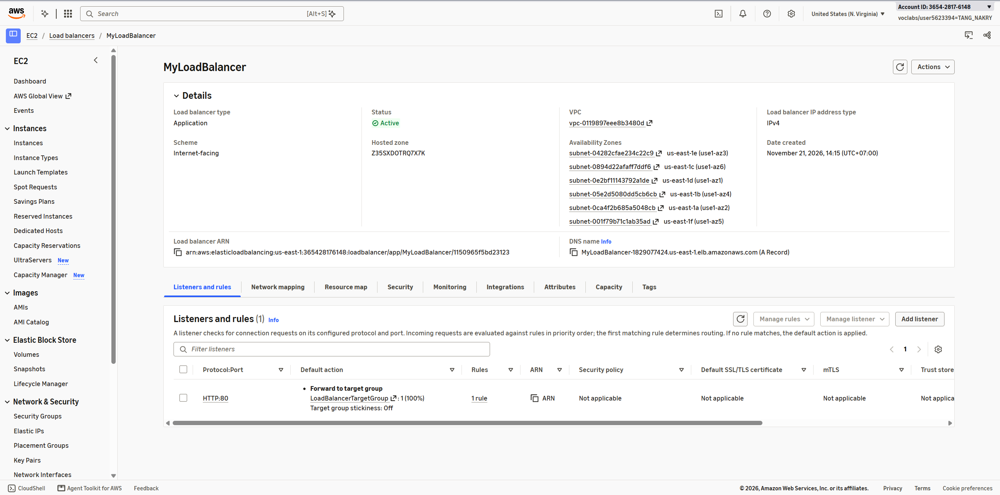

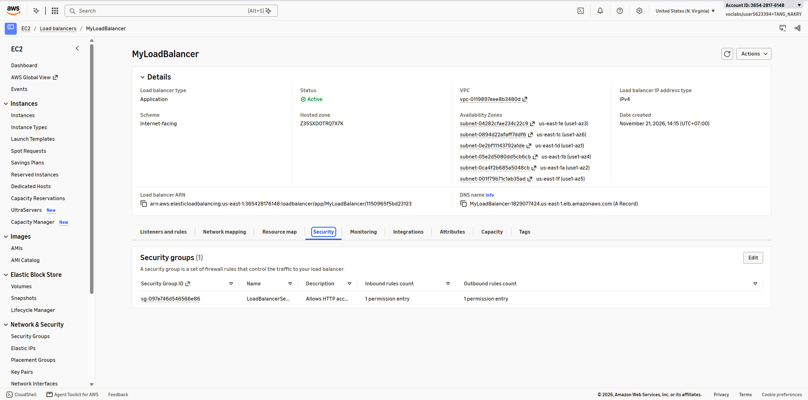

## Launch template

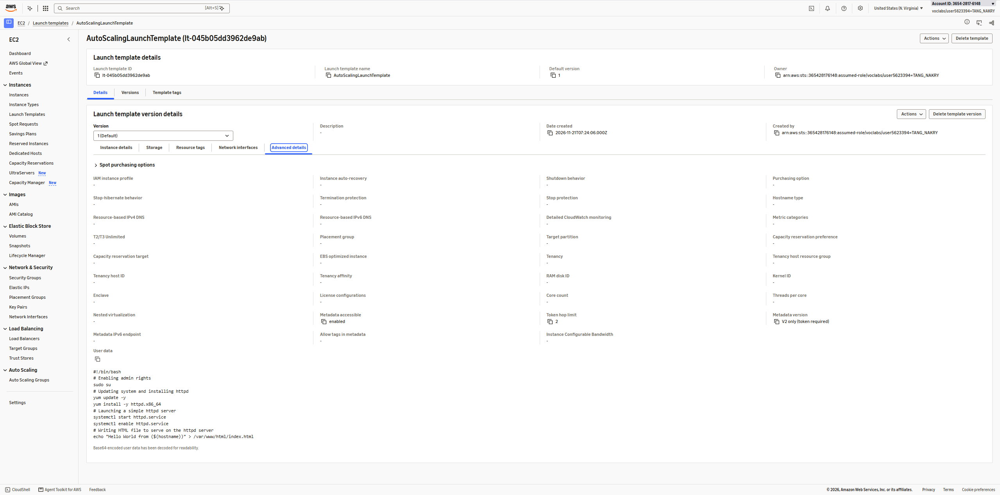

## Auto Scaling group

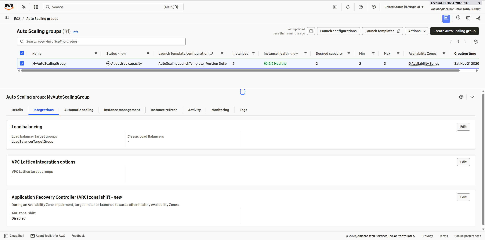

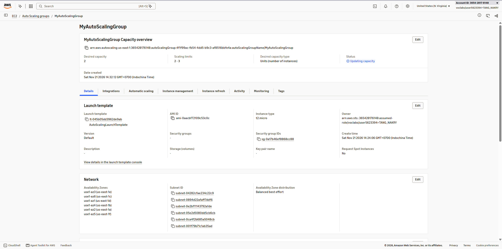

## Load balancing test

The first request was handled by
`ip-172-31-50-104.ec2.internal`.

The second request was handled by
`ip-172-31-43-177.ec2.internal`.

This shows that the load balancer successfully distributed
HTTP requests between two EC2 instances.

## Simulated application failure

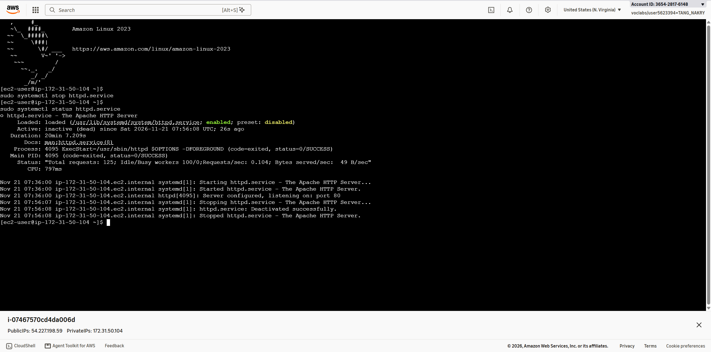

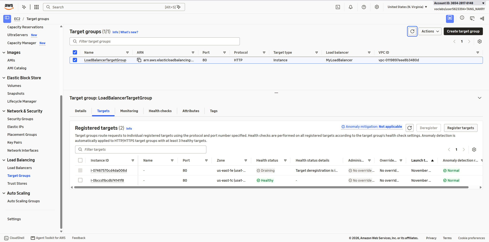

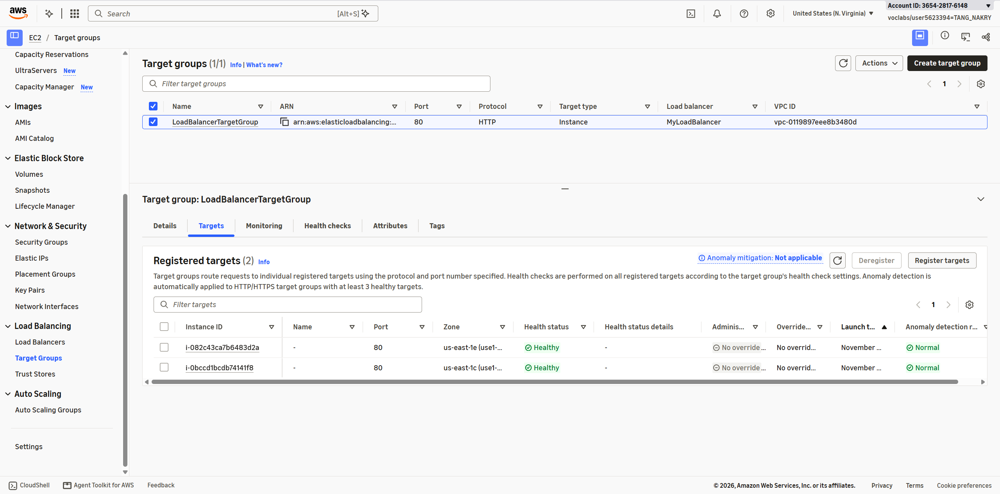

**About how many minutes passed between stopping `httpd`
and the new instance becoming healthy?**

I stopped the Apache HTTP service at 14:56:08 (UTC+7).
It took approximately [ENTER MINUTES] minutes for the
Auto Scaling group to replace the failed instance and
for the new instance to become healthy.

The failed instance was `i-07467570cd4da006d`.
It was replaced by `i-082c43ca7b6483d2a`.

After the replacement, both registered targets were healthy.

---

## Questions

### 1. Why does the page show a different host name when you refresh it?

The Application Load Balancer distributes incoming HTTP
requests between healthy EC2 instances. Each instance has
a different hostname. When I refresh the page, the load
balancer may forward my request to another instance,
which displays a different hostname.

### 2. After you stopped `httpd`, the instance was still *running* in EC2, but the target group marked it *unhealthy*. What did the health check test, and why did the instance fail it?

The health check sends an HTTP request to the root path
`/` on port 80 every 30 seconds and expects an HTTP 200
response.

After I stopped the `httpd` service, the web server could
no longer respond to HTTP requests. After two consecutive
failed health checks, the target was marked unhealthy,
even though the EC2 instance itself was still running.

### 3. Who replaced the failed instance: the load balancer, the target group, or the Auto Scaling group? Explain the role of each one.

The Auto Scaling group replaced the failed instance.

- **Load balancer:** Distributes incoming HTTP requests
  to healthy instances.
- **Target group:** Registers the instances, performs
  health checks, and tracks their health status.
- **Auto Scaling group:** Maintains the desired number
  of instances by terminating unhealthy instances and
  launching replacement instances.

### 4. With desired 2, minimum 2 and maximum 3, how many instances run normally? In what situation could there be 3?

Normally, two EC2 instances run because the desired
capacity is set to 2.

There could be three instances if the desired capacity
is increased to 3 manually or by a scaling policy, for
example when application traffic increases.

The maximum capacity of 3 allows the group to scale up
when necessary.

### 5. The instances' security group allows HTTP from anywhere. How could you change it so that the instances accept HTTP **only** from the load balancer?

I would edit the inbound rules of
`LaunchTemplateSecurityGroup`.

I would remove the HTTP rule with the source `0.0.0.0/0`
and add an HTTP rule on port 80 with
`LoadBalancerSecurityGroup` as the source.

This would allow HTTP traffic from the load balancer's
security group instead of allowing direct HTTP access
from anywhere on the internet.

---
