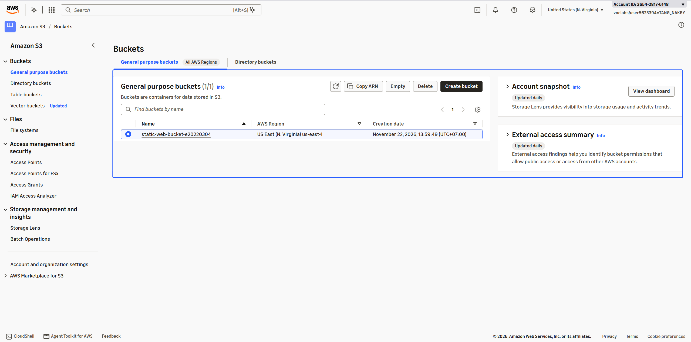
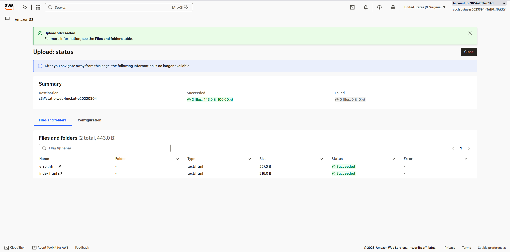
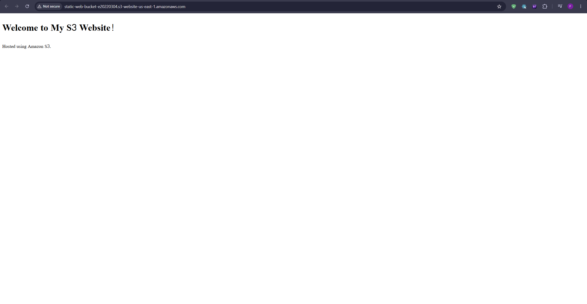
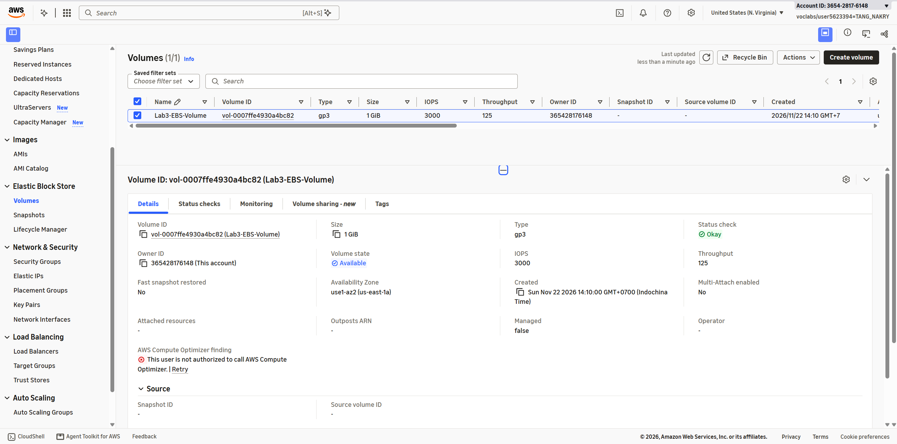
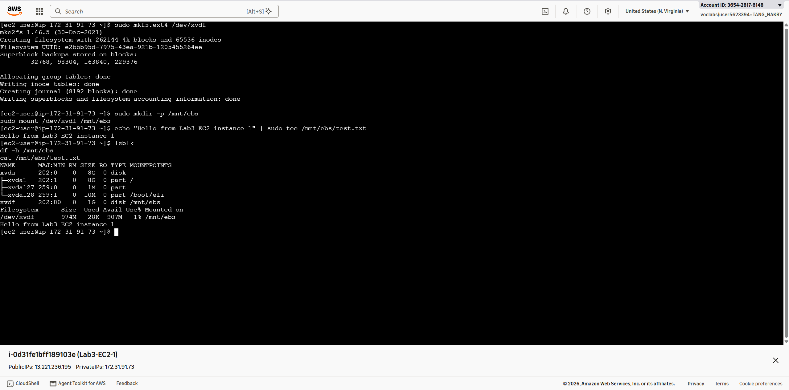
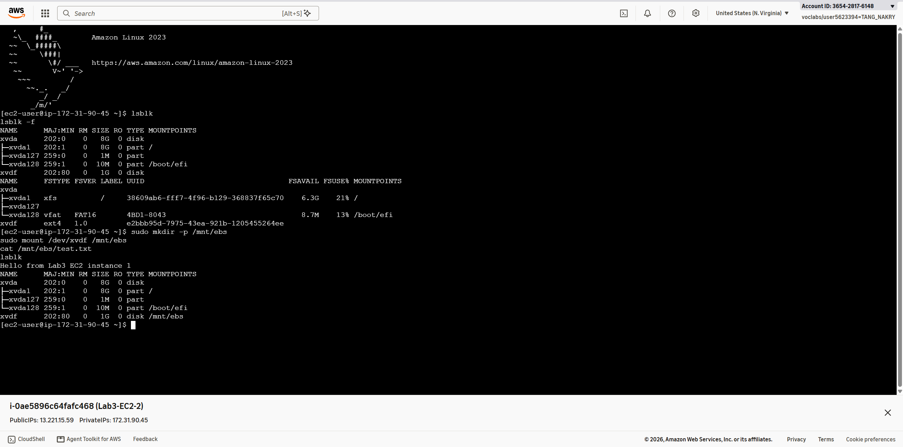
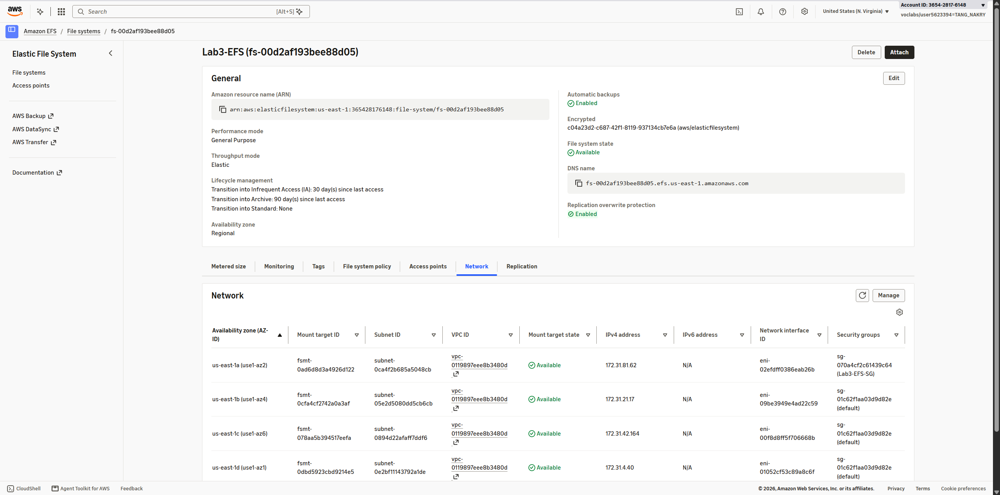
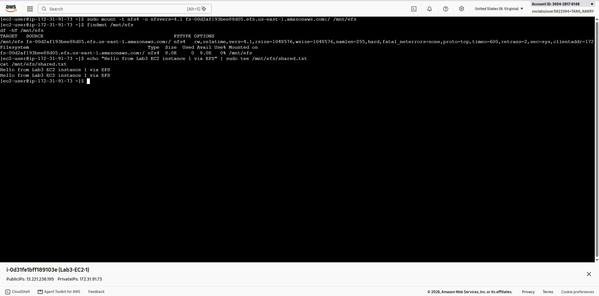
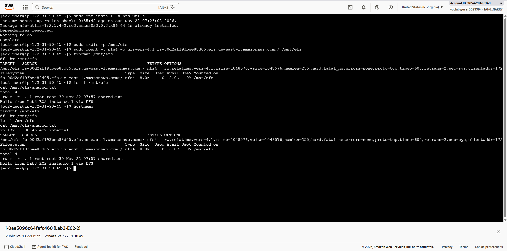

# Cloud Lab 3 Submission — AWS Storage Options

- **Student name:** TANG NAKRY
- **Student ID:** e20220304
- **Learner Lab user name:** voclabs/user5623394=TANG_NAKRY
- **Date completed:** 2026-11-22

---

## Part 2.1 — Amazon S3

### Bucket list

I created an S3 bucket named
`static-web-bucket-e20220304` in the `us-east-1` region.

### Uploaded files

I uploaded two HTML files:
- `index.html`
- `error.html`

Both files were uploaded successfully.

### Static website

I enabled static website hosting and configured public
read access using a bucket policy.

The website successfully displayed:

"Welcome to My S3 Website!"

Website endpoint:
http://static-web-bucket-e20220304.s3-website-us-east-1.amazonaws.com

---

## Part 2.2 — Amazon EBS

### Volumes page

I created a 1 GiB gp3 EBS volume named `Lab3-EBS-Volume`
in Availability Zone `us-east-1a`.

Volume ID: `vol-0007ffe4930a4bc82`

### Attached volume (`lsblk`)

**Which device name did your volume get
(`xvdf`, `nvme1n1`, ...)?**

My EBS volume appeared as `/dev/xvdf`.

I formatted it using the ext4 filesystem and mounted
it at `/mnt/ebs` on `Lab3-EC2-1`.

I then created a test file named `test.txt` containing:

`Hello from Lab3 EC2 instance 1`

### File read on instance-2

I unmounted and detached the EBS volume from
`Lab3-EC2-1`, then attached it to `Lab3-EC2-2`.

After mounting the volume, I successfully read the
original `test.txt` file.

This demonstrates that data stored on an EBS volume
can persist when the volume is moved between EC2
instances in the same Availability Zone.

---

## Part 2.3 — Amazon EFS

### File system and mount targets

I created an EFS file system named `Lab3-EFS`.

File system ID: `fs-00d2af193bee88d05`

I configured the mount target in `us-east-1a` and
attached the `Lab3-EFS-SG` security group.

The security group was configured to allow NFS
traffic on TCP port 2049 from both EC2 instances'
security groups.

### File created on instance-1

I mounted the EFS file system on `Lab3-EC2-1`
at `/mnt/efs` using NFS version 4.1.

I created a file named `shared.txt` containing:

`Hello from Lab3 EC2 instance 1 via EFS`

The `findmnt` and `df -hT` commands confirmed that
the filesystem was mounted using NFS.

### File listed on the second instance

I mounted the same EFS file system on `Lab3-EC2-2`.

Without copying the file, I successfully read
`shared.txt` and obtained the same contents.

This demonstrates that multiple EC2 instances can
access the same EFS file system simultaneously.

---

## Questions

### 1. After you turned on static website hosting, the endpoint first answered 403 Forbidden. Why, and what changed after you added the bucket policy?

The 403 Forbidden error occurs because enabling S3
static website hosting does not automatically grant
public access to the objects.

S3 blocks unauthorized public requests unless the
appropriate permissions are configured.

After adding a bucket policy allowing public
`s3:GetObject` access to the website files, visitors
could retrieve the HTML pages.

In my lab, I confirmed that the website loaded
successfully after configuring the bucket policy.

### 2. `testfile.txt` was still there after you moved Backup Volume to `instance-2`. What would have happened to a file saved on `instance-1`'s root volume after terminating `instance-1`?

A file stored on the root EBS volume would normally
be deleted when the EC2 instance is terminated,
because the root volume is usually configured with
Delete on Termination enabled.

The separate EBS data volume can be detached and
reattached to another instance without losing data.

This is why my test file remained available after
moving the EBS volume to `Lab3-EC2-2`.

### 3. Why did you run `mkfs` on `instance-1` but not on `instance-2`?

I ran `mkfs.ext4` on the first instance because
the new EBS volume did not yet have a filesystem.

Formatting prepared the volume to store files.

When I attached the same volume to the second
instance, it already contained an ext4 filesystem
and my test file.

Running `mkfs` again would recreate the filesystem
and could erase the existing data. Therefore, I
only mounted the volume on the second instance.

### 4. Why could `instance-1` and `instance-3` use the EFS file system at the same time, when an EBS volume had to be detached first? Why did they have to be in the subnets of the mount targets?

Amazon EFS is a network file system that supports
simultaneous access from multiple EC2 instances
using NFS.

Amazon EBS is block storage normally attached to
one EC2 instance at a time, so I had to detach the
volume before attaching it to another instance.

EFS mount targets provide network access to the
file system inside a VPC. The instances need network
connectivity to a mount target, and security groups
must allow NFS traffic on TCP port 2049.

In my lab, both EC2 instances used `us-east-1a`,
where an EFS mount target was available.

### 5. For each need, choose S3, EBS or EFS and give one reason.

**(a) A website's images — Amazon S3**

S3 is suitable for storing website images because
it provides scalable object storage and can serve
static content over HTTP.

**(b) The disk of a database server — Amazon EBS**

EBS is suitable for a database server because it
provides persistent block storage with low-latency
read and write operations.

**(c) A folder shared by several web servers — Amazon EFS**

EFS is suitable because multiple EC2 instances can
mount the same file system and access shared files
simultaneously.

---
