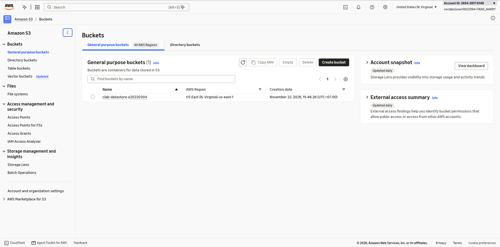
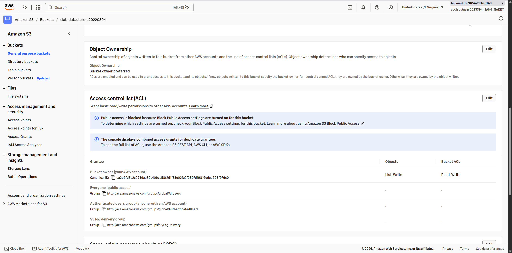
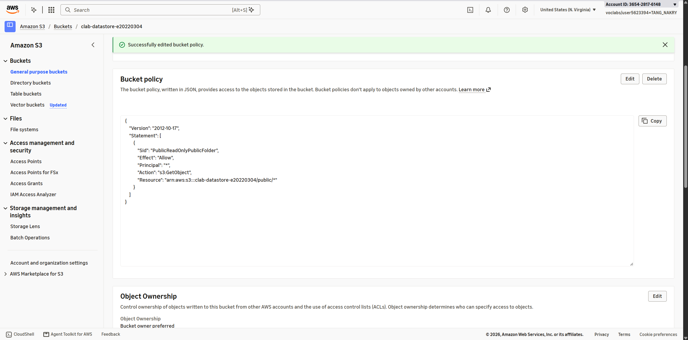
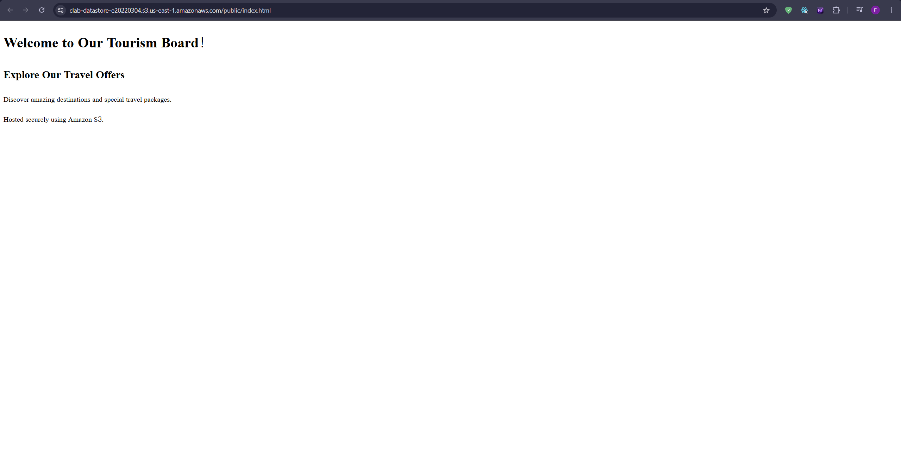
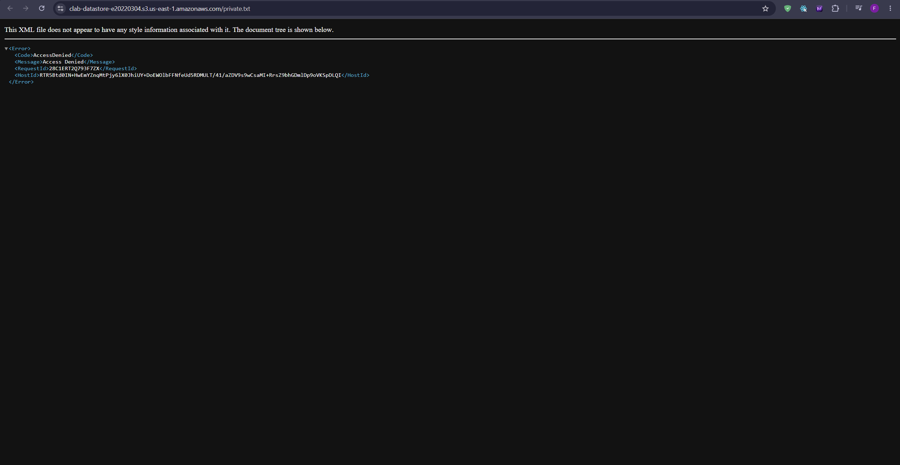
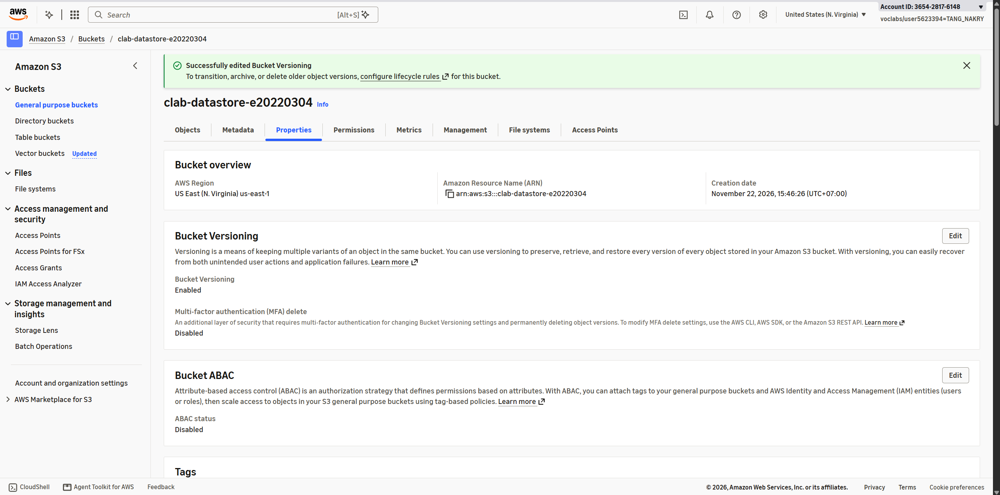
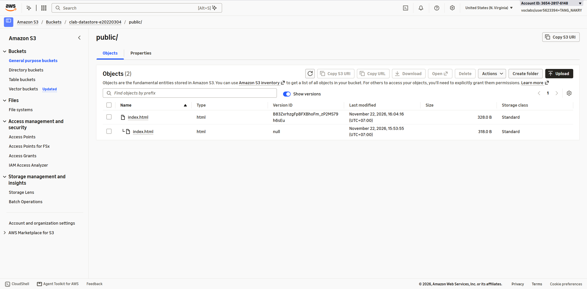
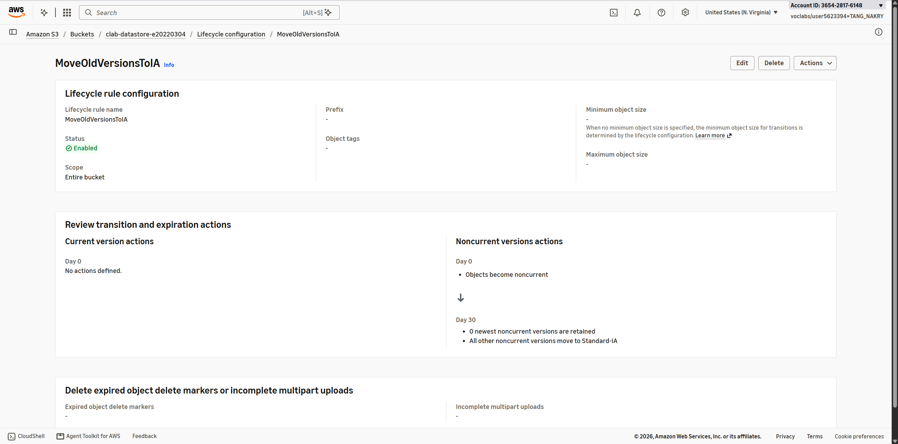

# Cloud Lab 3 Challenge Submission — Secure S3 Bucket

- **Student name:** TANG NAKRY
- **Student ID:** e20220304
- **Learner Lab user name:** `voclabs/user5623394=TANG_NAKRY`
- **Bucket name:** `clab-datastore-e20220304`
- **Date completed:** November 22, 2026

---

## 1. Bucket

I created an Amazon S3 bucket named `clab-datastore-e20220304` in the US East (N. Virginia) region (`us-east-1`). The bucket name begins with the required prefix `clab-datastore`.

## 2. Object ownership

I configured Object Ownership as **Bucket owner preferred**, with **ACLs enabled**, as required by the challenge.

## 3. Public access policy

I created a bucket policy allowing public read access only to objects inside the `public/` folder.

I tested the public object URL and successfully opened `public/index.html`, which displayed the tourism board webpage.

I also tested `private.txt`, located outside the `public/` folder. Amazon S3 returned an `AccessDenied` error, confirming that the private file was not publicly accessible.

My policy is in [bucket-policy.json](bucket-policy.json).

**Which line limits public access to the `public/` folder?**

The following line limits public read access to objects inside the `public/` folder:

`"Resource": "arn:aws:s3:::clab-datastore-e20220304/public/*"`

The `public/*` prefix restricts the policy's public-read permission to objects in that folder. Files outside this prefix, such as `private.txt`, are not granted public access by the policy.

## 4. Versioning

I enabled S3 Bucket Versioning to preserve previous versions of files when they are updated or overwritten.

I tested versioning by uploading an updated `public/index.html` file. Amazon S3 retained both the current version and the previous version.

## 5. Lifecycle rule

I created a lifecycle rule named `MoveOldVersionsToIA`.

The rule is enabled, applies to the entire bucket, and transitions noncurrent object versions to **S3 Standard-IA** 30 days after they become noncurrent.

---

## Questions

### 1. You turned off parts of Block Public Access for this bucket. Why was that needed, and why is it still safe for the objects outside `public/`?

I needed to disable the Block Public Access settings that prevent public bucket policies from being applied. This allowed the tourism board's public travel offers to be accessed through their S3 object URLs.

Objects outside the `public/` folder remain private because my bucket policy grants public `s3:GetObject` permission only to objects matching `public/*`. I verified this by successfully opening `public/index.html` while receiving an `AccessDenied` error when attempting to open `private.txt`.

### 2. What is a noncurrent version? Give an example from your own test.

A noncurrent version is an older version of an S3 object that is preserved when a newer version is uploaded.

In my test, I uploaded an updated `public/index.html` after enabling versioning. The new version was 328 bytes, while the previous version was 318 bytes. Amazon S3 preserved the older file as a noncurrent version with version ID `null`, because it was originally uploaded before versioning was enabled.

This demonstrates how versioning allows previous content to be recovered when necessary.

### 3. Why move noncurrent versions to S3 Standard-IA instead of deleting them?

Moving noncurrent versions to S3 Standard-IA can reduce storage costs while preserving older versions for future recovery.

Older versions are accessed less frequently, so Standard-IA is suitable for storing them at a lower storage rate, although retrieval charges and minimum storage duration charges may apply.

Keeping older versions allows the tourism board to restore previous content if an update contains errors or important information needs to be recovered.

My lifecycle rule transitions noncurrent versions to Standard-IA after 30 days.

---